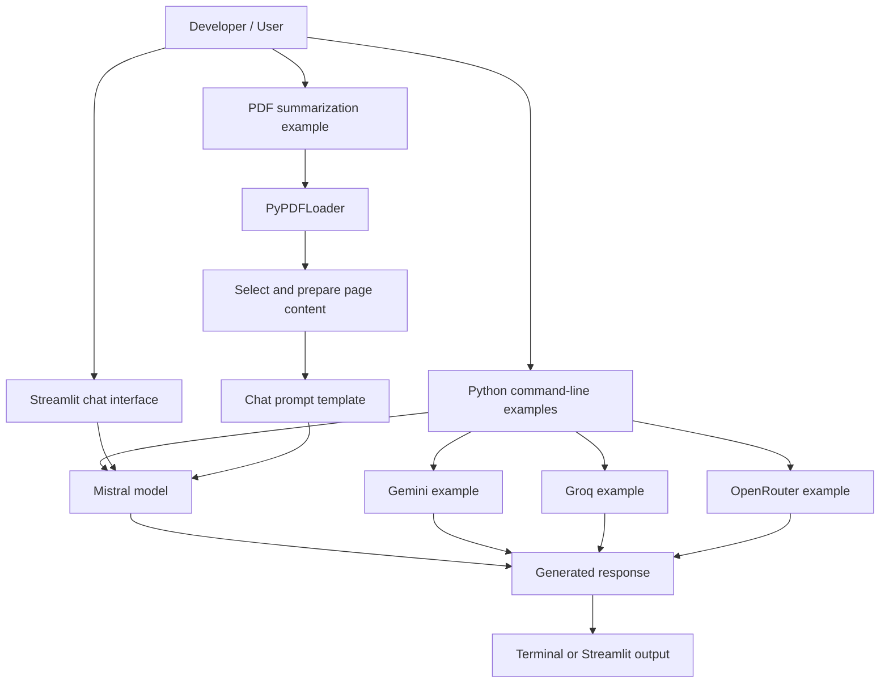
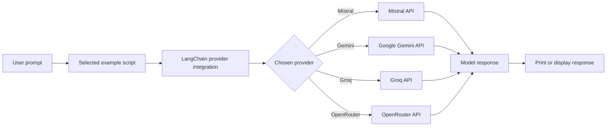
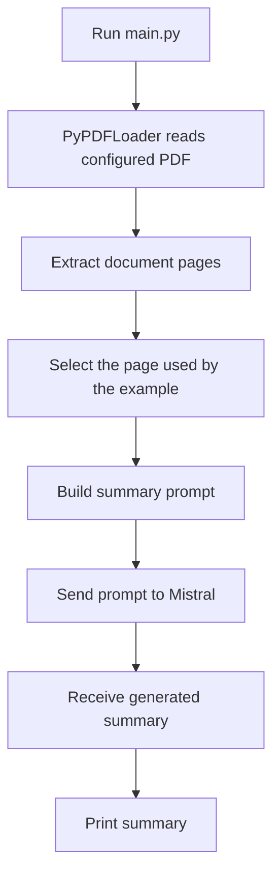
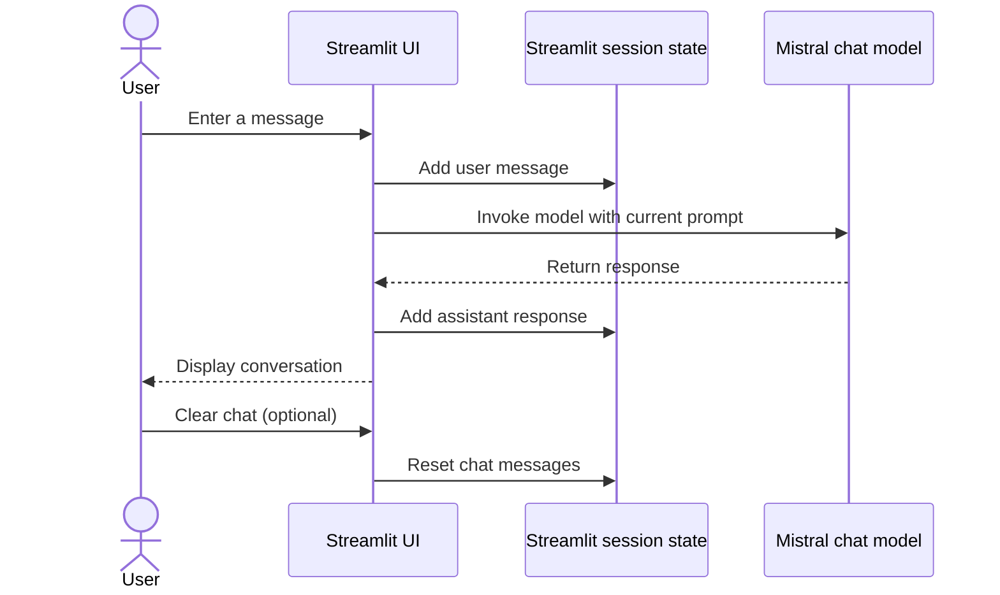
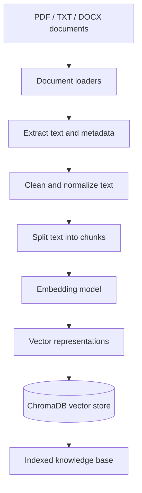
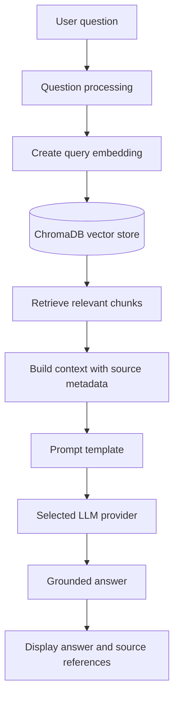
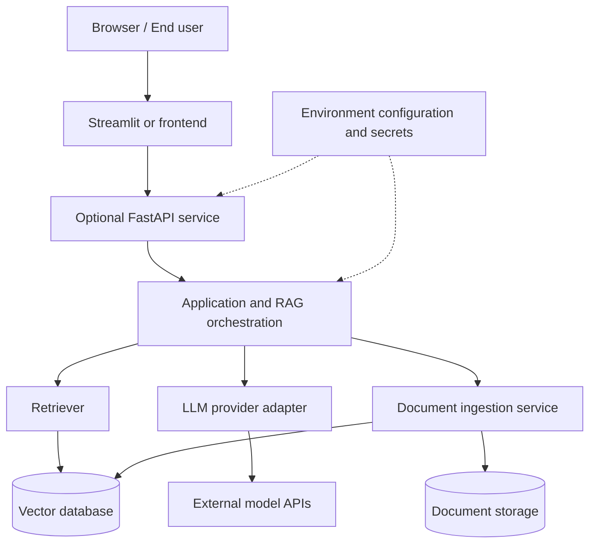

# RAG Chat Models

A Python learning and experimentation project for interacting with multiple Large Language Model (LLM) providers through **LangChain**. It contains standalone model examples, a Streamlit chat interface, and introductory PDF/text document-loading scripts.

> **Project status:** This repository is currently an LLM integration and document-loading playground. Although the repository name is RAG Chat Models, a complete Retrieval-Augmented Generation (RAG) workflow is not implemented yet. The current code does not connect document chunking, embeddings, vector storage, retrieval, and grounded answer generation into one application. The future enhancements section describes how contributors can help build those capabilities.

---

## Table of contents

- [Project overview](#project-overview)
- [Current capabilities](#current-capabilities)
- [Technology stack](#technology-stack)
- [Repository structure](#repository-structure)
- [Architecture](#architecture)
- [How each component works](#how-each-component-works)
- [Execution workflows](#execution-workflows)
- [Installation and setup](#installation-and-setup)
- [Configuration and API keys](#configuration-and-api-keys)
- [Running the project](#running-the-project)
- [Understanding RAG](#understanding-rag)
- [Current limitations](#current-limitations)
- [Future enhancements and community contributions](#future-enhancements-and-community-contributions)
- [Troubleshooting](#troubleshooting)
- [Security](#security)
- [Contributing](#contributing)
- [License](#license)

## Project overview

The goal of this project is to explore how different hosted LLM providers can be called from Python using LangChain, and how document content can be loaded for later processing. Each provider example is a small, independent script, making it easier to understand the integration without requiring a complete application stack.

The project currently demonstrates two related areas:

1. **LLM interaction:** sending a prompt to a provider and printing the generated response, or displaying a conversation in a Streamlit interface.
2. **Document loading and summarization:** loading PDF or text files as LangChain documents, and summarizing a selected PDF page with a prompt template and a Mistral model.

These examples are useful building blocks for a future document-aware chat application. They should not yet be described as a production RAG system.

## Current capabilities

| Capability | Current implementation |
|---|---|
| Mistral model integration | Yes — terminal chat, Streamlit chat, and PDF-page summarization examples |
| Google Gemini integration | Yes — basic prompt/response example |
| Groq integration | Yes — basic prompt/response example |
| OpenRouter integration | Yes — basic prompt/response example |
| Streamlit user interface | Yes — Mistral chat interface with session-based message history |
| PDF loading | Yes — PyPDFLoader examples |
| Text-file loading | Yes — TextLoader example |
| Prompt templates | Yes — used by the PDF summarization example |
| PDF/text chunking | Not implemented in the current scripts |
| Embedding generation | Not implemented in the current workflow |
| Vector database indexing and retrieval | Not implemented in the current workflow |
| Complete RAG question-answering pipeline | Not implemented yet |

## Technology stack

- **Python** — application and example scripts.
- **LangChain** — common interfaces for model calls, prompts, and document loaders.
- **Mistral AI** — model provider used by the main chat and summarization examples.
- **Google Gemini** — alternate LLM provider example.
- **Groq** — alternate hosted model example.
- **OpenRouter** — API gateway example for accessing supported models.
- **Streamlit** — browser-based chat user interface.
- **LangChain Community** — document loader integrations such as PDF and text loaders.
- **python-dotenv** — loading local environment variables from a .env file.

## Repository structure

~~~text
RAG_Chat_Models/
│
├── Documents_load/
│   ├── pdf_load.py          # Load a PDF and inspect a selected page
│   └── text_load.py         # Load a text file and inspect a selected document
│
├── Gemini_chat.py           # Basic Gemini model invocation
├── groq_chat.py             # Basic Groq model invocation
├── main.py                  # Load a PDF page and summarize it with Mistral
├── mistral.py               # Interactive terminal chat with Mistral
├── mistral_UI.py            # Streamlit chat interface using Mistral
├── openrouter_model.py      # Basic OpenRouter model invocation
│
├── requirements.txt         # Python dependencies
├── .gitignore               # Excludes local environment files and virtual environments
└── README.md                # Project documentation
~~~

## Architecture

### 1. Current high-level architecture

The repository contains independent scripts. They share the idea of using LangChain to call a model, but they do not currently run behind a common backend or a unified provider-selection layer.

~~~mermaid
flowchart TB
    U[Developer / User]
    U --> PY[Python example scripts]
    PY --> LC[LangChain integrations]
    LC --> MI[Mistral AI]
    LC --> GE[Google Gemini]
    LC --> GR[Groq]
    LC --> OR[OpenRouter]

    U --> UI[Streamlit chat UI]
    UI --> MUI[Mistral LangChain client]
    MUI --> MI

    PDF[PDF file] --> PL[PyPDFLoader]
    TXT[Text file] --> TL[TextLoader]
    PL --> DOC[LangChain Document objects]
    TL --> DOC
    DOC --> INSPECT[Print / inspect loaded content]

    PDF2[PDF file] --> MAIN[main.py]
    MAIN --> LOAD[PyPDFLoader]
    LOAD --> PAGE[Select third page]
    PAGE --> PROMPT[ChatPromptTemplate]
    PROMPT --> SUM[Mistral model]
    SUM --> RESULT[Print summary]
~~~

### 2. Model invocation workflow

The provider scripts follow a simple request-response pattern:

~~~mermaid
flowchart TD
    A[Start Python script] --> B[Load environment variables]
    B --> C[Initialize provider-specific LangChain chat model]
    C --> D[Create prompt or read user input]
    D --> E[Invoke model]
    E --> F[Receive model response]
    F --> G[Print response]
~~~

In the current examples, each script initializes its own provider client. There is no automatic fallback between providers if one provider is unavailable.

### 3. Streamlit chat workflow

~~~mermaid
flowchart TD
    A[User opens Streamlit app] --> B[Initialize page and cached Mistral client]
    B --> C[Initialize session message history if needed]
    C --> D[Render previous messages]
    D --> E[User enters a prompt]
    E --> F[Add user message to session state]
    F --> G[Invoke Mistral model]
    G --> H[Render assistant response]
    H --> I[Save assistant response in session state]
    I --> D
    D --> J[User selects Clear Chat]
    J --> K[Clear session history and rerun app]
~~~

The chat history is held in Streamlit session state. It is not a persistent database, and the current implementation does not send the entire saved history as conversational context to the model; each submitted prompt is invoked directly.

### 4. PDF summarization workflow

~~~mermaid
flowchart TD
    A[Start main.py] --> B[Load .env variables]
    B --> C[PyPDFLoader reads configured PDF]
    C --> D[Create one Document per PDF page]
    D --> E[Select docs index 2: third page]
    E --> F[Build ChatPromptTemplate]
    F --> G[Insert selected page text into context]
    G --> H[Initialize Mistral model]
    H --> I[Invoke model with prompt]
    I --> J[Print summary]
~~~

This is document-based summarization, not retrieval-augmented question answering. It reads a fixed page rather than searching a vector index for relevant passages.

## How each component works

### main.py — PDF page summarization

This script demonstrates a small document-to-LLM workflow.

1. Loads environment variables with python-dotenv.
2. Creates a PyPDFLoader for a PDF file.
3. Loads the PDF into a list of LangChain Document objects. Each page is represented as a document with page content and metadata.
4. Selects the item at index 2, which is the third page.
5. Defines a ChatPromptTemplate with a system instruction and a human message.
6. Inserts the selected page text into the prompt's context variable.
7. Initializes ChatMistralAI with the configured model name.
8. Invokes the model and prints the returned summary.

**Important:** the script currently contains a machine-specific Windows PDF path. Change it to a valid local path before running. The PDF must contain at least three pages for docs[2] to exist.

### mistral.py — terminal-based Mistral chat

This script creates a Mistral chat model and runs an input loop:

1. Load environment variables.
2. Initialize ChatMistralAI.
3. Wait for the user to enter a message.
4. Send the message to the model with invoke().
5. Print the model's response.
6. Continue until the user enters exit.

The current loop sends each input independently. It does not maintain a conversation memory or pass earlier turns back to the model.

### mistral_UI.py — Streamlit chat application

This script provides a browser-based chat experience.

- **Page configuration:** sets the page title, icon, and wide layout.
- **Styling:** adds custom CSS for the page title, subtitle, and chat messages.
- **Model initialization:** load_llm() creates a ChatMistralAI client and uses Streamlit's cache_resource decorator to reuse the resource across reruns.
- **Session state:** initializes a messages list for the current Streamlit session.
- **Sidebar:** displays a temperature slider and a Clear Chat button.
- **Message rendering:** loops through saved session messages and displays them using Streamlit chat components.
- **Prompt handling:** reads the user's new prompt, appends it to session history, invokes the model, displays the response, and appends the assistant response.

**Current implementation note:** the temperature slider is displayed, but its selected value is not passed into the cached model instance. The model is currently initialized with a fixed temperature of 0.7. Also, although messages are displayed from session state, the current model invocation sends only the latest prompt rather than the complete conversation history.

### Gemini_chat.py — Google Gemini example

This is a minimal provider integration example:

1. Load environment variables.
2. Initialize ChatGoogleGenerativeAI with the model name shown in the script.
3. Send a sample question using invoke().
4. Print response.content.

The script expects the Google API credential to be available in the environment under the variable name supported by the installed integration (commonly GOOGLE_API_KEY).

### groq_chat.py — Groq example

This script initializes ChatGroq with the model identifier configured in the source code, sends a sample question, and prints the response. It requires a valid Groq API key, commonly supplied as GROQ_API_KEY.

### openrouter_model.py — OpenRouter example

This script initializes ChatOpenRouter with the model identifier configured in the source code, sends a sample question, and prints the response. It requires an OpenRouter API key, commonly supplied as OPENROUTER_API_KEY.

The file also contains a commented-out example that requests the OpenRouter models endpoint and filters model identifiers containing :free. That commented code is illustrative and is not executed during normal script execution.

### Documents_load/pdf_load.py — PDF document loading

This example uses LangChain Community's PyPDFLoader to load a PDF and prints one selected page/document. It is intended to demonstrate loading and inspecting PDF content. The path in the current script is specific to one developer machine and must be changed before use.

### Documents_load/text_load.py — text document loading

This example uses LangChain Community's TextLoader to load a text file and prints one selected loaded document. Its current file path is also machine-specific and must be changed before use.

### requirements.txt — dependencies

The requirements file groups dependencies for the current examples and possible future work. It includes LangChain packages, provider-related base packages, document-processing libraries, Streamlit, vector database and embedding-related packages, and utilities.

Not every package listed is currently used by an active script, and some provider adapter packages imported by the source files are not explicitly listed. In particular, the examples import langchain-mistralai, langchain-google-genai, langchain-groq, and langchain-openrouter. Install the required provider integrations separately if they are not already present in your environment. For reproducible installations, pin and test compatible package versions.

## Execution workflows

### Run the terminal Mistral chatbot

1. Activate the virtual environment.
2. Configure MISTRAL_API_KEY in .env.
3. Install the Mistral LangChain integration.
4. Run:

~~~bash
python mistral.py
~~~

5. Enter prompts in the terminal.
6. Enter exit to stop the loop.

### Run the Streamlit Mistral chatbot

1. Activate the virtual environment.
2. Configure MISTRAL_API_KEY.
3. Install Streamlit and the Mistral LangChain integration.
4. Run:

~~~bash
streamlit run mistral_UI.py
~~~

5. Open the local URL printed by Streamlit.
6. Enter a prompt in the chat box.

### Run the provider examples

Configure the corresponding provider credential and run the script:

~~~bash
python Gemini_chat.py
python groq_chat.py
python openrouter_model.py
~~~

Each example makes a request to its configured provider and prints the response. Provider model identifiers can change over time; check the provider's current model availability if an invocation fails.

### Run the PDF summarizer

1. Edit the PDF path in main.py.
2. Confirm the PDF has at least three pages.
3. Configure MISTRAL_API_KEY.
4. Run:

~~~bash
python main.py
~~~

### Run the document loader examples

Update the relevant file path first, then run:

~~~bash
python Documents_load/pdf_load.py
python Documents_load/text_load.py
~~~

## Installation and setup

### Prerequisites

- Python installed on your system.
- pip, Python's package installer.
- An API key for the model provider you want to test.
- A PDF or text file for the document-loading examples.
- Internet access for hosted model API requests.

### Clone the repository

~~~bash
git clone https://github.com/angadkumar9128/RAG_Chat_Models.git
cd RAG_Chat_Models
~~~

### Create a virtual environment

**Windows PowerShell**

~~~powershell
python -m venv .venv
.\.venv\Scripts\Activate.ps1
~~~

**macOS / Linux**

~~~bash
python3 -m venv .venv
source .venv/bin/activate
~~~

### Install project dependencies

~~~bash
python -m pip install --upgrade pip
pip install -r requirements.txt
~~~

Install the provider adapters used by the scripts if they are not already installed:

~~~bash
pip install langchain-mistralai langchain-google-genai langchain-groq langchain-openrouter
~~~

Because package APIs and model availability evolve, use a tested dependency set for repeatable environments.

## Configuration and API keys

Create a .env file in the root directory. Add only the credentials for the integrations you plan to run:

~~~dotenv
MISTRAL_API_KEY=your_mistral_api_key
GOOGLE_API_KEY=your_google_api_key
GROQ_API_KEY=your_groq_api_key
OPENROUTER_API_KEY=your_openrouter_api_key
~~~

The provider integrations may use their documented environment-variable names. Do not add quotes unless required by your environment setup, and never commit real credentials.

The repository's .gitignore excludes .env, .venv/, and venv/. Keep those entries in place.

## Understanding RAG

**Retrieval-Augmented Generation (RAG)** is an approach in which an application retrieves relevant information from a document collection and provides that information to an LLM as context when answering a question.

A typical RAG system has two major workflows.

### A. Document ingestion and indexing

~~~mermaid
flowchart TD
    A[Upload documents] --> B[Load documents]
    B --> C[Clean and normalize text]
    C --> D[Split text into chunks]
    D --> E[Generate embeddings]
    E --> F[Store vectors and metadata]
    F --> G[(Vector database)]
~~~

### B. User question and retrieval

~~~mermaid
flowchart TD
    A[User asks a question] --> B[Embed the question]
    B --> C[Search vector database]
    C --> D[Retrieve relevant chunks]
    D --> E[Build context-aware prompt]
    E --> F[Send prompt and context to LLM]
    F --> G[Generate answer]
    G --> H[Return answer with source references]
~~~

These diagrams explain the intended future direction. The current repository has basic document loaders and LLM calls, but does not yet implement these complete ingestion and retrieval workflows.

## Current limitations

The following points are based on the source files currently in the repository:

- The scripts are standalone examples rather than one integrated application.
- PDF and text paths are hard-coded to local Windows locations.
- The PDF summarization script selects the third page by a fixed index.
- The terminal Mistral script does not preserve conversation context between prompts.
- The Streamlit app displays session chat history but invokes the model with only the latest prompt.
- The Streamlit temperature control is not connected to model initialization.
- Provider selection and automatic fallback are not implemented.
- The current document loaders do not perform chunking, embedding, vector indexing, or retrieval.
- There is no complete RAG chain, source-grounded response validation, or document upload interface.
- There is no automated test suite in the current repository.
- Provider adapter packages imported by scripts are not all explicitly declared in requirements.txt.
- The license for reuse and redistribution has not been specified.

## Future enhancements and community contributions

This project is intended to grow through learning, experimentation, and community contributions. The following are proposed improvements, not features that should be considered available today. Contributors are welcome to implement them, improve existing code, add tests, or suggest better approaches.

### 1. Build a complete RAG pipeline

- Add document ingestion for PDF, TXT, DOCX, and other useful formats.
- Add text cleaning, normalization, and configurable chunking.
- Generate embeddings using selectable embedding models.
- Store and manage embeddings in ChromaDB or another vector database.
- Implement semantic search and configurable retrieval strategies.
- Pass retrieved passages into a grounded LLM prompt.
- Return source filenames, page numbers, and relevant excerpts with answers.

### 2. Improve the chat experience

- Add persistent conversation history.
- Pass conversation context to the model when appropriate.
- Support document upload and document-specific conversations.
- Add streaming responses and a stop-generation control.
- Add configurable system prompts and model parameters.
- Add chat export, conversation deletion, and session management.

### 3. Multi-provider model management

- Build a common provider interface for Mistral, Gemini, Groq, and OpenRouter.
- Allow users to select a provider and model from the UI.
- Validate credentials and display useful configuration errors.
- Add optional fallback behavior when a provider is unavailable or rate-limited.
- Make model settings such as temperature configurable and ensure the UI values are applied.

### 4. Retrieval quality and evaluation

- Add metadata filters and configurable top-k retrieval.
- Explore hybrid search combining keyword and vector search.
- Add reranking to improve the relevance of retrieved passages.
- Evaluate answer relevance, faithfulness, and retrieval quality with repeatable test datasets.
- Handle questions for which the document collection contains no reliable answer.

### 5. Application architecture and reliability

- Separate UI, services, model clients, ingestion, retrieval, and configuration into clear modules.
- Add a FastAPI backend if an API layer is useful.
- Add structured logging, error handling, retries, and rate-limit handling.
- Add automated unit and integration tests.
- Add Docker support and a documented deployment workflow.
- Add dependency version constraints and continuous integration checks.

### 6. Security and document management

- Improve secret management and configuration validation.
- Add file type and file size validation for uploads.
- Avoid logging sensitive document contents or credentials.
- Document data retention and deletion behavior.
- Add access controls if the project evolves into a multi-user application.

### 7. Documentation and developer experience

- Add setup instructions for Windows, macOS, and Linux.
- Add example environment configuration without real secrets.
- Add sample documents that are safe to distribute.
- Add architecture decision records and implementation examples.
- Keep the README synchronized with actual implemented behavior.

### Contribution ideas for beginners

You do not need to implement the entire RAG system to contribute. Small, focused improvements are valuable:

- Replace one hard-coded path with a configurable path.
- Add input validation to a document loader.
- Add a test for a utility or loader.
- Fix the Streamlit temperature control.
- Add conversation context to the chat workflow.
- Improve an error message or setup instruction.
- Add support for one additional document format.
- Implement one isolated RAG component, such as a text splitter or vector-store adapter.

## Troubleshooting

| Problem | What to check |
|---|---|
| Missing API key | Confirm the correct key is present in the root .env file and that load_dotenv() runs before model initialization. |
| Provider package import error | Install the provider's LangChain adapter, not only the base provider SDK. |
| Model not found or unavailable | Verify the model identifier and your account's access with the provider. |
| PDF file not found | Replace the hard-coded path with the actual path on your computer. |
| IndexError in PDF summarization | The script reads the third page; use a PDF with at least three pages or change the selected index. |
| Streamlit command not found | Activate the virtual environment and install the requirements. |
| API rate limit or authentication error | Check provider credentials, account limits, quota, and provider status. |

## Security

- Never commit API keys, tokens, passwords, or private documents.
- Keep .env and virtual-environment directories out of version control.
- Use environment variables or a dedicated secret manager for credentials.
- Review the data-handling terms of hosted LLM providers before sending private or sensitive documents.
- Treat model output as untrusted content; validate it before using it in downstream systems.

## Contributing

Contributions are welcome! You can help by fixing bugs, improving documentation, adding tests, implementing one of the proposed enhancements, or suggesting new features.

### Suggested contribution workflow

1. Fork the repository.
2. Clone your fork locally.
3. Create a focused branch for your change.
4. Install the project dependencies and run the relevant example.
5. Make a small, clearly scoped change.
6. Add or update tests and documentation where appropriate.
7. Run the relevant checks and review your changes.
8. Commit your work with a descriptive commit message.
9. Push your branch to your fork.
10. Open a Pull Request describing the problem, your solution, and how you tested it.

~~~bash
git checkout -b feature/your-feature-name
# Make and test your changes
git add .
git commit -m "feat: describe your contribution"
git push origin feature/your-feature-name
~~~

For larger changes, open an issue first so the proposed design can be discussed before implementation. Please avoid combining unrelated changes in one pull request. Be respectful, explain your reasoning, and include screenshots for meaningful UI changes.

### Contribution checklist

- [ ] The change has a clear purpose and scope.
- [ ] Existing examples still work where applicable.
- [ ] New behavior has tests when practical.
- [ ] Documentation reflects the actual implementation.
- [ ] No API keys, private files, or other secrets are included.
- [ ] The pull request explains what changed and how it was tested.

## License

No license file is currently present in this repository. Until a license is added, the project should not be assumed to grant permission for reuse, modification, or redistribution. A maintainer should choose and add an explicit license before inviting reuse under specific terms.

---

**If you find this project useful, consider starring the repository, reporting issues, and contributing improvements.**

## Additional architecture diagrams

These diagrams distinguish the **current implementation** from the **proposed future architecture**. The future diagrams are design targets, not claims that those components are already implemented.

### 1. Current project architecture

This view shows the existing standalone scripts and their shared role as examples for interacting with different language-model providers.

**How to read it:** users run an individual Python script or launch the Streamlit interface. The selected script calls its configured model provider and displays the generated response. The PDF example loads a PDF page, places its text into a prompt, and asks the Mistral model to summarize it.

### 2. Model-provider interaction

The repository contains separate examples for Mistral, Gemini, Groq, and OpenRouter. Each example constructs a provider-specific LangChain chat model and sends it a prompt.

The provider is selected by running the corresponding script; this is not yet a unified provider switcher or automatic failover system.

### 3. PDF summarization workflow (current example)

**Current scope:** the example demonstrates PDF loading and LLM-based summarization. It currently uses a locally configured file path and selects a specific page; it is not yet a general-purpose multi-document RAG pipeline.

### 4. Streamlit chat workflow (current example)

The current UI keeps displayed messages in Streamlit session state. The current implementation sends the latest prompt to the model rather than providing the full prior conversation as model context, so persistent conversational memory is a future improvement.

### 5. Proposed RAG ingestion architecture (future enhancement)

A Retrieval-Augmented Generation (RAG) pipeline first prepares documents and indexes their chunks. This is a proposed contribution, not functionality currently completed in the repository.

### 6. Proposed RAG question-answering architecture (future enhancement)

In this design, retrieved document passages are supplied to the language model as context. The application should show source references and clearly indicate when the indexed documents do not contain enough information to answer.

### 7. Proposed deployment architecture (future enhancement)

This is a possible production-oriented direction. FastAPI, a separate ingestion service, external document storage, and a deployed vector database should be treated as future work until implemented and configured.

### Diagram maintenance

When contributing code, update the relevant **current implementation** diagram if behavior changes. Keep planned components in the future-architecture sections until they are actually implemented. Mermaid diagrams can be previewed in GitHub Markdown and in compatible Markdown editors.
